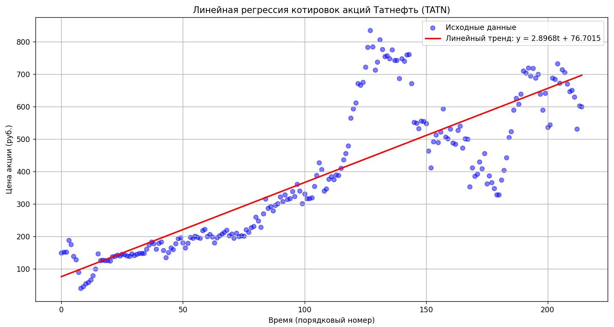
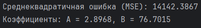

# Linear Regression - TATN Stock Trend

Анализ временных рядов котировок акций **Татнефть (TATN)** методом линейной регрессии и наименьших квадратов.

---

## О проекте

Проект строит линейный тренд цены акции по времени, оценивает его качество и визуализирует результат.

**Возможности:**

1. Загрузка исторических котировок TATN из Excel
2. Преобразование дат в порядковые номера $t = 0, 1, 2, \ldots$
3. Расчёт коэффициентов $A$ и $B$ линейной модели методом наименьших квадратов
4. Построение графика исходных данных и линейного тренда
5. Оценка качества модели через среднеквадратичную ошибку (MSE)

---

## Структура репозитория

```text
├── linear_regression.py   # Реализация линейной регрессии
├── TATN.xlsx              # Исторические котировки акций Татнефть
├── requirements.txt       # Зависимости Python
├── images/                # Графики и скриншоты результатов
└── README.md              # Описание проекта и теория
```

---

## Требования

- Python 3.8+

```bash
pip install -r requirements.txt
```

---

## Запуск

```bash
python linear_regression.py
```

Скрипт:

- читает `TATN.xlsx`
- считает коэффициенты $A$, $B$ и MSE
- показывает график «исходные данные + линейный тренд»

---

## Теория

### 1. Анализ данных и регрессия

**Анализ данных** - извлечение полезной информации из сырых данных (эксперимент, экономика, котировки и т.п.). Сырые данные сами по себе обычно не содержат явных закономерностей; их нужно выявлять.

Задачи анализа данных условно делятся на два класса:

1. **Построение трендов** - восстановление компактной характеристики всего набора данных (data set), которая описывает данные «в среднем», а не каждую точку точно.
2. **Обучение по образцам** - модель учится воспроизводить правильный ответ по входным данным (supervised learning).

Переход от сложных сырых данных к более простой математической модели называется **регрессией** (от сложного к простому). Комплекс таких подходов - **регрессионный анализ**.

В регрессии:

- есть **вход** (input) и **выход** (output);
- модель - математическое выражение, связывающее выход со входом через **подстроечные параметры**;
- цель - подобрать параметры так, чтобы модель максимально хорошо воспроизводила данные **в среднем** (тренд), а не каждую точку.

### 2. Линейная регрессия

**Линейная регрессия** - регрессионная модель зависимости одной объясняемой (зависимой) переменной $y$ от одной или нескольких независимых переменных $x$ с **линейной** функцией зависимости.

Здесь рассматривается простейший случай: зависимость котировки от времени.

Модель:

$$
y = A \cdot t + B \tag{1}
$$

где:

- $y$ - значение котировки акции;
- $t$ - время (порядковый номер наблюдения);
- $A$ - коэффициент наклона (насколько меняется $y$ при изменении $t$ на единицу);
- $B$ - свободный член (значение $y$ при $t = 0$).

Пространство вариантов модели - все возможные пары коэффициентов $(A, B)$. Нужно найти **наилучшую** прямую, то есть такие $A$ и $B$, при которых модель лучше всего описывает данные.

### 3. Целевая функция и метод наименьших квадратов

Чтобы сравнивать разные прямые, каждому варианту $(A, B)$ ставится в соответствие число - значение **целевой функции**. Лучшая прямая - та, у которой ошибка воспроизведения data set минимальна.

Для каждой точки $i$:

1. модель даёт предсказание $A \cdot t_i + B$;
2. сравниваем его с реальным значением $y_i$;
3. получаем отклонение $A \cdot t_i + B - y_i$.

Отклонения нельзя просто суммировать: положительные и отрицательные ошибки компенсируют друг друга. Поэтому отклонения **возводят в квадрат** - так ошибка всегда неотрицательна, а ноль целевой функции возможен только если каждая точка воспроизведена идеально.

**Метод наименьших квадратов (МНК)** - метод, основанный на минимизации суммы квадратов отклонений модели от экспериментальных данных. Это один из базовых методов регрессионного анализа для оценки параметров модели по выборке.

Целевая функция:

$$
E(A, B) = \sum_{i=1}^{N} \left( A \cdot t_i + B - y_i \right)^2 \tag{2}
$$

где:

- $N$ - число точек в data set;
- $t_i$ - значение аргумента (времени) в $i$-й точке;
- $y_i$ - реальное значение котировки в $i$-й точке.

Задача: найти $A$ и $B$, минимизирующие $E(A, B)$.

Минимизацию можно выполнять по-разному (поиск по сетке, Монте-Карло, генетический алгоритм, градиентный спуск). Для линейной регрессии существует **аналитическое** решение: минимум находится из условия равенства нулю градиента.

### 4. Градиент и условие минимума

**Градиент** - вектор частных производных функции по всем её переменным.

Для функции двух переменных $E(A, B)$ минимум достигается в точке, где обе частные производные равны нулю:

$$
\frac{\partial E}{\partial A} = \sum_{i=1}^{N} 2\left( A \cdot t_i + B - y_i \right) \cdot t_i = 0
$$

$$
\frac{\partial E}{\partial B} = \sum_{i=1}^{N} 2\left( A \cdot t_i + B - y_i \right) = 0
$$

### 5. Упрощение системы уравнений

Раскрываем скобки и упрощаем:

$$
\begin{cases}
\sum_{i=1}^{N} \left( A \cdot t_i^{2} + B \cdot t_i - y_i \cdot t_i \right) = 0 \\
\sum_{i=1}^{N} \left( A \cdot t_i + B - y_i \right) = 0
\end{cases}
$$

### 6. Средние значения

Для удобства вводится обозначение среднего арифметического:

$$
\langle k_i \rangle = \frac{1}{N} \sum_{i=1}^{N} k_i
$$

После деления уравнений на $N$ система записывается через средние:

$$
\begin{cases}
A \cdot \langle t_i^{2} \rangle + B \cdot \langle t_i \rangle = \langle y_i \cdot t_i \rangle \\
A \cdot \langle t_i \rangle + B = \langle y_i \rangle
\end{cases}
$$

### 7. Решение относительно $A$ и $B$

Умножаем второе уравнение на $\langle t_i \rangle$:

$$
A \cdot \langle t_i \rangle^{2} + B \cdot \langle t_i \rangle = \langle y_i \rangle \cdot \langle t_i \rangle
$$

Вычитаем его из первого:

$$
A \cdot \left( \langle t_i^{2} \rangle - \langle t_i \rangle^{2} \right) = \langle y_i \cdot t_i \rangle - \langle y_i \rangle \cdot \langle t_i \rangle
$$

Отсюда коэффициент наклона:

$$
A = \frac{\langle y_i \cdot t_i \rangle - \langle y_i \rangle \cdot \langle t_i \rangle}{\langle t_i^{2} \rangle - \langle t_i \rangle^{2}}
$$

Подставляя $A$ во второе уравнение, получаем свободный член:

$$
B = \langle y_i \rangle - A \cdot \langle t_i \rangle
$$

### 8. Итоговые формулы коэффициентов

$$
A = \frac{\langle y_i \cdot t_i \rangle - \langle y_i \rangle \cdot \langle t_i \rangle}{\langle t_i^{2} \rangle - \langle t_i \rangle^{2}}
$$

$$
B = \langle y_i \rangle - A \cdot \langle t_i \rangle
$$

Смысл параметров:

- $A$ - наклон прямой: насколько изменяется $y$ при изменении $t$ на единицу;
- $B$ - значение $y$ при $t = 0$ (свободный член).

Для расчёта на практике достаточно четырёх средних по data set:

| Среднее | Обозначение | Смысл |
|---|---|---|
| $\langle t_i \rangle$ | `t_mean` | среднее время |
| $\langle y_i \rangle$ | `y_mean` | средняя цена |
| $\langle t_i^{2} \rangle$ | `t_squared_mean` | среднее квадратов времени |
| $\langle y_i \cdot t_i \rangle$ | `t_y_mean` | среднее произведений $t \cdot y$ |

### 9. Линейный тренд и оценка качества

После нахождения $A$ и $B$ значения тренда в каждой точке:

$$
y_{\mathrm{trend}}(t) = A \cdot t + B
$$

Качество модели оценивается **среднеквадратичной ошибкой (MSE)**:

$$
\mathrm{MSE} = \frac{1}{N} \sum_{i=1}^{N} \left( y_i - y_{\mathrm{trend}}(t_i) \right)^{2} = \langle (y_i - A t_i - B)^{2} \rangle
$$

Чем меньше MSE, тем лучше линейная модель описывает данные. Высокое MSE означает, что динамика ряда существенно нелинейна и простой прямой недостаточно для полного описания, хотя общий тренд она всё же может отражать.

---

## Как это работает

1. Загрузка `TATN.xlsx`
2. Преобразование дат в $t = 0..N-1$
3. Расчёт $\langle t \rangle$, $\langle y \rangle$, $\langle t^{2} \rangle$, $\langle t y \rangle$
4. Вычисление $A$ и $B$ по формулам выше
5. Построение $y_{\mathrm{trend}} = A t + B$
6. Визуализация и расчёт MSE

---

## Результаты

Полученная модель:

$$
y = 2.8968\,t + 76.7015
$$





Линейный тренд отражает общую тенденцию изменения котировок TATN, но реальные точки заметно отклоняются от прямой. Высокое значение MSE подтверждает, что динамика акций не является строго линейной: возможны локальные нелинейные участки (ускоренный рост/падение и т.п.).

Линейная регрессия полезна для выявления **общей тенденции**, но не полностью описывает сложную динамику рынка.
